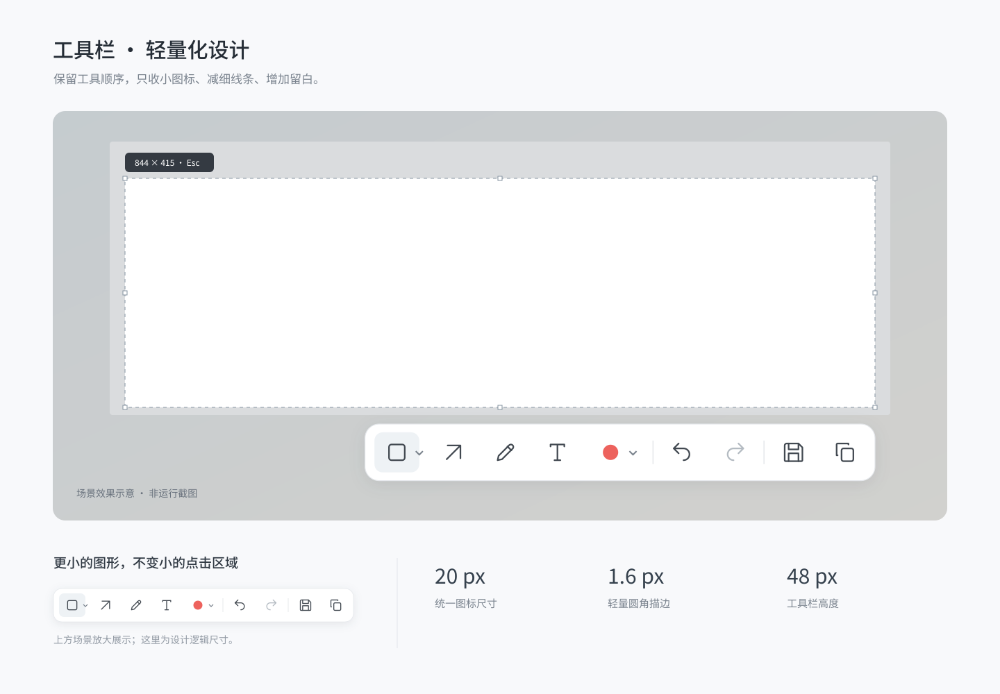

# 拾光截图

拾光截图是一个常驻 Windows 通知区域的截图工具：按下全局热键，拖选一块屏幕区域，直接在上面画框、箭头或写文字，按 **Enter** 复制、按 **Ctrl + S** 另存为 PNG，按 **Esc** 放弃。它不打断当前工作，也不把截图塞进历史列表——退出时结果从内存释放。

## 核心流程

1. **呼出**：按 **Ctrl + Shift + S**，或右键托盘图标选择「区域截图」。此刻只显示桌面遮罩，剪贴板不受影响。
2. **框选**：左键拖选，松开即锁定选区。支持跨屏、混合 DPI 与错位排列的显示器。
3. **标注**：在工具栏选择矩形、圆、椭圆、三角形、菱形、箭头、画笔、文字或颜色；撤销、重做只作用于本次编辑。
4. **交付**：**Enter** 复制到剪贴板，**Ctrl + S** 另存 PNG，或点击工具栏右侧的复制 / 保存图标。完成或取消本次截图后，托盘菜单仍可复制或另存最近一次结果。

## 界面

两张图是最终界面设计稿（交互与视觉定稿），**不是 Windows 运行截图**；实际渲染由 Win32 与 Leaf 实现。

## 使用说明

### 截图与标注

- 选区锁定后即可标注。点击工具栏的文字工具（T 图标）进入文字录入，选区内可直接用中文输入法；按 **Enter** 或切换工具把文字加入截图。
- 形状、箭头和画笔使用工具栏选定的颜色；工具栏不会进入导出结果。
- 裁剪、标注合成与导出都按物理像素处理。错位显示器之间既未被覆盖也未被标注的区域，在 PNG 中保持透明。

### 完成、取消与失败重试

- 在文字录入框之外按 **Enter** 复制，或按 **Ctrl + S** 另存 PNG。保存不会覆盖已有文件。
- 取消另存、剪贴板被其他进程占用或保存失败时，选区和标注仍然保留，可以重试；托盘另存不受当前编辑会话影响。
- 按 **Esc** 放弃本次编辑，不替换上一次截图或剪贴板内容（输入法正在组字时，Esc 可能先交给输入法处理）。

### 托盘与设置

- 程序启动后只在通知区域出现一个图标，可能折叠在「^」中。点击图标或在菜单中打开「设置」。
- 设置窗口关闭只是隐藏，截图热键继续有效；从设置窗口或托盘菜单都能彻底退出。
- 设置是 Leaf 绘制的 Win32 窗口，与托盘、热键、采集、标注共用同一个 UI 消息循环。

## 快捷键

| 按键 | 作用 |
| --- | --- |
| **Ctrl + Shift + S** | 默认的全局区域截图快捷键，可在设置中更换 |
| **Enter** | 文字录入时把文字加入截图；其余情况下复制整张截图 |
| **Ctrl + S** | 另存为 PNG（文字录入框外） |
| **Esc** | 放弃本次编辑；录入新快捷键时取消录入 |

更换快捷键：点击当前组合键旁的「更改」，在设置窗口保持前台时按下新组合键；切换走焦点后录入不再生效，按 **Esc** 取消。组合键必须包含 **Ctrl**、**Alt** 或 **Win** 中至少一个，可再加 **Shift**；主键支持字母、数字、**F1–F24（F12 除外）**、空格，以及 PgUp / PgDn / Home / End / 方向键 / Ins / Del。系统保留、已被占用或写入失败时保留原快捷键；成功后写入当前用户配置，重启后仍生效。

## 限制与已知边界

- 仅支持 Windows x64（Windows 10 1703 或更新）。
- 屏幕采集通过 GDI 逐屏读取，不保证各显示器在同一硬件刷新时刻同步；快速变化的画面可能出现屏间时间差。
- 受保护内容与 UAC 安全桌面不在支持范围内。
- 不提供截图历史或云同步；只保留内存中的最近一次结果。
- 另存不会覆盖已有文件：目标已存在时本次保存失败，原文件保持不变，可换名重试。
- 项目当前没有发布包或 Release，只能从源码构建。

## 架构与适用系统

| 文件 | 职责 |
| --- | --- |
| `src/shiguang.nim` | 应用入口、设置窗口状态与消息循环接线 |
| `src/desktop_win.c` | 托盘、全局热键、桌面遮罩、选区交互 |
| `src/editor.c` / `src/editor_win.c` | 标注模型与历史、工具栏布局、Win32 编辑窗口 |
| `src/settings_view.nim` | 设置界面的视图描述与快捷键键帽 |
| `src/export_win.c` | 剪贴板 DIB 与 WIC PNG 导出、原子落盘 |
| `src/crop.c` | 选区几何换算与多屏拼接（纯 C，无平台依赖） |

一次截图的数据流：读取各屏冻结位图 → 换算物理像素矩形并拼接 → 在编辑层叠加标注 → 合成导出位图 → 写入剪贴板或经 WIC 编码为 PNG。导出 PNG 时先写同目录临时文件，再以不覆盖的方式原子改名；目标已存在则安全失败。

## 构建

需要 Windows x64、Nim **2.2.6+**、PATH 中的 x64 MinGW-w64 GCC，以及相邻目录 `../leaf` 的 [Leaf](https://github.com/SatoriTours/Leaf) 源码。已核实 Leaf `0.1.0` checkout `df53b244383bc79abd3d8a035d4ac29636602444`，无需修改 Leaf。

在项目根目录的 PowerShell 执行：

~~~powershell
New-Item -ItemType Directory -Force build | Out-Null
nim c -d:release --cc:gcc --app:gui --path:../leaf/src --nimcache:build/nimcache --out:build/shiguang.exe src/shiguang.nim
if ($LASTEXITCODE -ne 0) { throw "拾光截图构建失败" }
.\build\shiguang.exe
~~~

## 测试

测试分四层，覆盖范围与运行环境不同。

**1. 设置视图能力检查**（需要 Nim 与相邻的 Leaf 源码。对照 Leaf 的 Win32 能力表，检查五种设置视图是否只使用受支持的布局与组件；这是构建期的静态能力检查，不等于 Windows 运行验证）：

~~~sh
nim c -r --path:../leaf/src --nimcache:build/nimcache --out:build/settings_capabilities_test tests/settings_capabilities_test.nim
~~~

**2. 平台无关的 C 逻辑测试**（Linux 或 MinGW 可运行，覆盖裁切几何、编辑历史、工具栏布局与热键编码）：

~~~sh
out=$(mktemp -d)
cc -std=c11 -Wall -Wextra -Werror tests/crop_test.c src/crop.c -o "$out/crop-test" &&
  "$out/crop-test" &&
  cc -std=c11 -Wall -Wextra -Werror tests/editor_test.c src/editor.c src/crop.c -o "$out/editor-test" &&
  "$out/editor-test"
~~~

**3. Windows 回归程序**（6 项用例，需 Windows x64 桌面。用例不会修改用户剪贴板或注册表；`preview`、`edit`、`save-edit` 需要交互桌面，会短暂显示遮罩，`replace` 会临时注册测试组合键）：

~~~powershell
New-Item -ItemType Directory -Force build | Out-Null
gcc -std=c11 -D_WIN32_WINNT=0x0a00 tests/regression_win.c src/crop.c src/editor.c src/editor_win.c -o build/regression_win.exe -luser32 -lgdi32 -lmsimg32 -ldwmapi -lcomctl32 -lshell32 -ladvapi32 -lole32 -luuid -lwindowscodecs
if ($LASTEXITCODE -ne 0) { throw "回归程序构建失败" }
foreach ($case in 'save', 'hotkey', 'preview', 'replace', 'edit', 'save-edit') {
    .\build\regression_win.exe $case
    if ($LASTEXITCODE -ne 0) { throw "回归失败：$case" }
}
~~~

**4. 现场清单**（自动化测试覆盖不到的视觉、输入法与系统集成，需在真实 Windows 桌面核对。r5 已在单屏远程桌面完成其中部分条目，PNG 另存等项沿用未改动导出逻辑的前序实测，其余仍待验证）：

1. 用左上方副屏、100% / 150% 混合 DPI 和错位布局。对动态窗口截图，核对冻结画面、跨屏物理尺寸和 PNG 空洞；改变布局或 DPI 应使当前截图取消。
2. 在屏幕中部、底部、贴边和全屏选区检查工具栏下贴右对齐、翻上、内侧回退。检查形状和颜色弹层可点，窄屏仍能触达复制和保存。
3. 分别绘制五种形状、箭头、自由线条，录入中文，检查颜色和导出像素。核对撤销、重做可用态和新标注清空重做，中文输入时 Enter 和 Ctrl+S 不触发导出。快捷键复制后实际粘贴，退出后再粘贴。
4. 预置剪贴板文本与一份上次截图；检查拖选、空拖、编辑中按 Esc 均不替换这两项。取消另存、抢占同名文件或让测试进程占用剪贴板，确认保留编辑并可重试。另存对话框期间改变显示布局或 DPI，再选文件名，应取消本次截图且不生成该 PNG；托盘仍可另存上次结果。
5. 两次启动只出现一份通知区域图标，检查窗口与托盘的拾光品牌图标、菜单、键帽和「更改」入口。录入冲突键应保留旧值，录入可用键后关闭窗口并重启核持久化，最后从托盘退出。

### 验证状态

当前结论对应最终构建 r5：应用 SHA-256 `666353a4d9efc09a2063715916d79eeab7bc3bb64fd4afd7548735c57c98a29e`，回归程序 `d57d47094018e29f5ce83fd7a62d2692edad36298a222cfafeecd2321238213a`。Windows 结论均来自单屏远程桌面会话。

- 本机（非 Windows）检查：裁切 3 项与编辑 3 项在启用 ASan/UBSan 后通过；设置视图 5 项通过 Leaf Win32 能力合同检查，属构建期静态检查，不是 Windows 运行结果。
- Windows 单屏远程桌面：6 项回归（`save`、`hotkey`、`preview`、`replace`、`edit`、`save-edit`）全部 exit 0。
- 同一会话中的实际应用：从托盘打开设置，键帽与「更改」入口可用；改为 Ctrl+Shift+Space 后，再录入一个已被其他进程占用的组合，设置提示冲突并保留原快捷键；退出重启后键帽与全局热键仍为该组合；Esc 可取消录入，关闭设置窗口后可再次打开。
- 退出应用后，在另一程序中粘贴得到 537×199 图像。
- 另存与 PNG 导出的逻辑本轮未改，沿用同一导出逻辑前序实测：重定向盘与本地磁盘的 PNG 均可解码（415×199、419×197），同名目标不被覆盖（34 字节原文件保留）。
- 局限：仅在单屏远程桌面验证，未在真实硬件上核对多屏、混合 DPI、错位布局与窄屏工具栏，也未验证中文输入法组字、五种形状与箭头的实际绘制；不构成对全部硬件、显示配置或其他重定向实现的兼容性结论。

## 许可证

[MIT](LICENSE)
