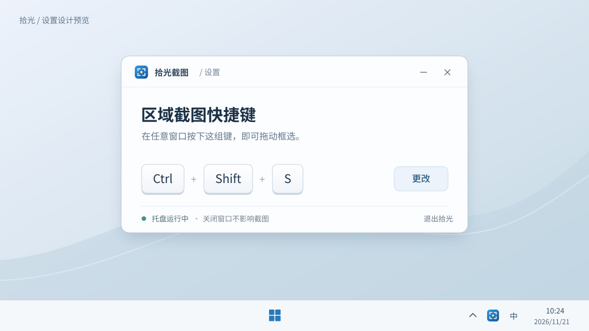

# 拾光截图

常驻 Windows 通知区域的截图工具：全局热键呼出，框选后就地标注，按 **Enter** 复制、**Ctrl + S** 另存 PNG。

主要功能：

- 托盘常驻、全局热键，不打断当前窗口；完成或取消后仍可复制或另存最近一次结果。
- 可在设置中选择是否随当前用户登录 Windows 启动，默认关闭。
- 框选后直接标注：矩形、圆、椭圆、三角形、菱形、箭头、画笔、文字与颜色，支持撤销、重做。
- 复制或另存为 PNG；绝不覆盖同名文件，失败时编辑内容保留，可重试。
- 跨屏与混合 DPI 按物理像素裁剪；快捷键可在设置中更换，写入当前用户配置。

## 三步上手

1. 启动 `shiguang.exe`，图标出现在通知区域（可能折叠在「^」中）。
2. 按 **Ctrl + Shift + S** 或右键托盘图标选「区域截图」，左键拖选，松开即锁定。
3. 标注后按 **Enter** 复制、**Ctrl + S** 另存，或按 **Esc** 放弃。

## 快捷键

| 按键 | 作用 |
| --- | --- |
| **Ctrl + Shift + S** | 全局区域截图，可在设置中更换 |
| **Enter** | 文字录入时把文字加入截图；其余情况复制整张截图 |
| **Ctrl + S** | 另存为 PNG（文字录入框外） |
| **Esc** | 放弃本次编辑；录入新快捷键时取消录入 |

## 界面设计稿

两张均为设计稿（设置图为冲突状态预览），**不是 Windows 运行截图**。

## 下载与文档

[下载 Windows x64 开发版](https://github.com/ToolDream/shiguang/releases)：选择最新的开发预发布，下载 `shiguang-windows-x64.zip`。

[使用指南](docs/usage.md) · [环境与构建](docs/build.md) · [测试与验收](docs/testing.md) · [构建与发布流水线](docs/release.md) · [MIT 许可证](LICENSE)
